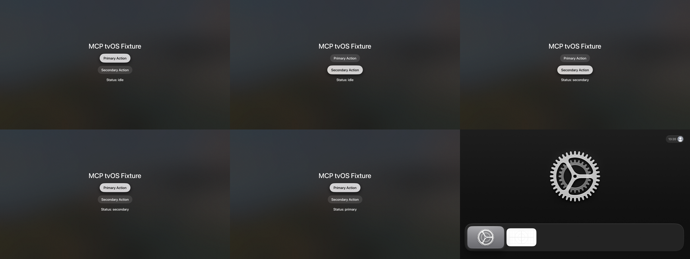
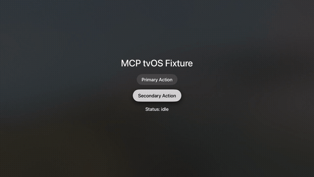

# 📱 MCP Server for iOS Simulator

[](https://glama.ai/mcp/servers/@InditexTech/mcp-server-simulator-ios-idb)

A Model Context Protocol (MCP) server that enables LLMs to interact with **iOS and tvOS simulators** through natural language commands.

## ℹ️ Overview

This MCP server provides a bridge between Large Language Models (LLMs) and Apple's CoreSimulator targets (**iOS** and **tvOS** simulators), offering comprehensive control through natural language commands. Here's what it can do:

For detailed usage, see the Installation guide and Supported Commands sections. You can use this server either through direct MCP integration or as a standalone library.

Check out the Architecture section to understand how the components work together to enable natural language control of iOS simulators. For the full execution flow, component contracts, and the session model, see [ARCHITECTURE.md](ARCHITECTURE.md). Guidance for agents and contributors working on this repository is in [AGENTS.md](AGENTS.md).


### 📺 tvOS demo (real Apple TV simulator)

Recorded against a disposable Apple TV simulator by sending natural-language instructions to the MCP server. Left to right, top to bottom: the focus starts on *Primary Action* (`Status: idle`); `press remote down` moves it to *Secondary Action*; `press remote select` activates it (`Status: secondary`); `pulsar mando arriba` moves it back; `press remote select` activates *Primary* (`Status: primary`); `press remote menu` returns to the tvOS home screen.





- [Full video (MP4)](demo/tvos/tvos-demo.mp4)
- [Instruction transcript](demo/tvos/transcript.md), including the honest rejection of `tap`, `swipe` and `set orientation` on a device without a touchscreen.

Reproduce it (requires Xcode, a tvOS Simulator runtime and `idb`; the script creates and deletes its own disposable simulator):

```bash
npm ci && npm run build
xcodebuild -downloadPlatform tvOS   # once, if no tvOS runtime is installed
node demo/tvos/demo-tvos.mjs ./tvos-demo-out
```

Accessibility reads (`focused`) and `tap element` on tvOS are not part of this demo; see the note on `idb` 1.7.8 under *Supported Commands*.

### 🎮 Simulator Control
- Create and manage simulator sessions
- Boot, shutdown, and monitor simulator states
- List available and running simulators
- Focus simulator windows

### 📱 Application Management
- Install and manage iOS applications
- Launch, terminate, and uninstall apps
- Monitor app states and verify installations
- Handle app permissions and configurations

### 🖱️ UI Interaction & Testing
- Interact with the simulator UI across touch (iOS) and focus-based (tvOS) interfaces
- Execute coordinate tap/swipe (iOS), Siri Remote navigation (`up`, `down`, `left`, `right`, `select`, `menu`), and hardware button presses (including `PLAY_PAUSE`, `VOLUME_UP`, `VOLUME_DOWN`, `EJECT`)
- Input text and key sequences
- Inspect focus-aware accessibility hierarchies (`focused`, `enabled`) and activate elements directly by label or identifier
- Record videos of UI interactions

### 🛠️ Development & Debugging
- Capture screenshots and system logs
- Debug applications in real-time
- Monitor and analyze crash logs
- Install dynamic libraries and manage app data

### ⚡ Advanced Features
- Additional functionality includes:
  - Location simulation
  - Media injection
  - URL scheme handling
  - Contact database management
  - Keychain operations

For detailed usage, see the Installation guide and Supported Commands sections. You can use this server either through direct MCP integration or as a standalone library.

Check out the Architecture section to understand how the components work together to enable natural language control of iOS simulators.

## 📋 Requirements

- **macOS**: 15 or later on Apple Silicon (arm64), required by idb
- **Node.js**: v24.22.1 LTS or later (CI uses 24.22.1)
- **npm**: v12.2.0 (install with `npm install --global npm@12.2.0` after selecting Node)
- **Homebrew**: Required for installing dependencies
- **Xcode**: 26 or later, selected as the active developer directory, with iOS simulators installed (install the optional **tvOS** Simulator runtime via `xcodebuild -downloadPlatform tvOS` when targeting Apple TV simulators)

> **Platform scope (iOS & tvOS Simulators vs. macOS):** This server automates sandboxed **CoreSimulator** targets (`iOS` and `tvOS`) through `xcrun simctl` and Meta's `idb` (`FBSimulatorControl` + `SimulatorFrameworkBridge-iOS` / `SimulatorFrameworkBridge-tvOS`). Native **macOS** and **Mac Catalyst** desktop applications are intentionally out of scope: CoreSimulator provides no macOS simulator, and `idb_companion`'s `MacDevice` target implements `xctest` bundle execution only (HID events, accessibility reads/actions, screenshots, video capture, and log streaming are unsupported on `MacDevice`).

## 🚀 Installation

The easiest way to install this server is through Cline:

1. Simply ask Cline:
```
Add this mcp to cline https://github.com/InditexTech/mcp-server-simulator-ios-idb
```

2. Cline will handle the installation process automatically, including dependency management and configuration.

Alternatively, you can install it manually:

```bash
# Clone the repository
git clone https://github.com/InditexTech/mcp-server-simulator-ios-idb.git
cd mcp-server-simulator-ios-idb

# Install the locked dependencies (also installs native idb dependencies)
npm ci

# Check TypeScript, including tests
npm run typecheck

# Build the project
npm run build

# Start the project
npm start

# Run tests
npm test

# Run opt-in integration tests against a real, disposable iOS simulator
# (never touch your existing simulators; requires idb + Xcode locally)
npm run test:integration

# Run opt-in integration tests against a real, disposable tvOS (Apple TV) simulator
# (requires an installed tvOS Simulator runtime in Xcode)
npm run test:integration:tvos
```

The installation process will automatically:
1. Check macOS 15+, Apple Silicon, Homebrew and Xcode 26+ prerequisites
2. Install the official `meta/fb/idb` Homebrew metapackage, which provides matching client and companion versions (currently 1.7.8); on Homebrew versions with trust controls, trust only the `idb`, `idb-cli` and `idb-companion` formulae
3. Verify the effective executable paths and versions

Python and its dependencies are managed by Homebrew; no project virtual environment is needed. If migrating from the old installation, deactivate the old venv and ensure Homebrew's `bin` directory is on the PATH used by your terminal and MCP host. The installer rejects executables that shadow Homebrew's installation; it does not delete the old venv.

Homebrew follows the current stable tap rather than `package-lock.json`. Record the installed versions with `brew list --versions meta/fb/idb meta/fb/idb-cli meta/fb/idb-companion`. To update an existing native installation, run `brew update && brew upgrade meta/fb/idb meta/fb/idb-cli meta/fb/idb-companion`, then rerun `npm ci` to verify it.

If you installed `idb` from the older `facebook/fb` tap (GitHub renamed the `facebook` organization to `meta`), Homebrew refuses to install the same formula names from `meta/fb`. The installer detects this from the installed receipts, changes nothing and stops with instructions. Migrate once, then rerun the installation (the installer re-establishes formula trust for `meta/fb/idb`, `meta/fb/idb-cli` and `meta/fb/idb-companion`):

```bash
brew uninstall idb idb-cli idb-companion
npm ci
```

## 🔌 MCP Integration

To use this server with Claude or other LLM assistants:

1. Add the server to your MCP settings in Claude Desktop:

```json
{
  "mcpServers": {
    "ios-simulator": {
      "command": "node",
      "args": ["/path/to/mcp-server-simulator-ios-idb/dist/index.js"],
      "env": {}
    }
  }
}
```

2. The LLM can now use natural language commands to control iOS simulators:

```
create a simulator session with iPhone 14
install app /path/to/my-app.ipa
launch app com.example.myapp
tap at 100, 200
take a screenshot
```

## 📚 Usage as a Library

You can also use this package as a library in your own projects:

### 🔰 Basic Usage

> ⚠️ **Import side effects**: importing the package entry point
> (`'mcp-server-simulator-ios-idb'` / `dist/index.js`) runs the server startup
> code at module load: it overrides console output, creates a `logs/`
> directory, registers `SIGINT`/`SIGTERM`/exception handlers, and **starts the
> MCP stdio server unconditionally**. There is currently no opt-out. This
> applies to *any* import of the package root — named imports do not opt out
> of the bootstrap. To use the parser/orchestrator/manager without transport
> and signal side effects, import the compiled component modules by **deep
> path** as shown below (`dist/...`); note that importing
> `dist/mcp/mcp-server.js` also bootstraps the MCP server singleton, so avoid
> that path for library use. The package only declares `"main"` (no `exports`
> map), so deep paths resolve normally.

```typescript
// Deep imports of compiled component modules: these do NOT trigger the
// package root startup (no MCP stdio server, no signal handlers).
import { MCPOrchestrator } from 'mcp-server-simulator-ios-idb/dist/orchestrator/MCPOrchestrator.js';
import { NLParser } from 'mcp-server-simulator-ios-idb/dist/parser/NLParser.js';
import { IDBManager } from 'mcp-server-simulator-ios-idb/dist/idb/IDBManager.js';

async function main() {
  // Compose the components (equivalent to createMCPServer internals)
  const idbManager = new IDBManager();
  const parser = new NLParser();
  const orchestrator = new MCPOrchestrator(parser, idbManager);

  // Process natural language commands

  // Create a simulator session
  const sessionResult = await orchestrator.processInstruction('create session');
  console.log(`Session created: ${sessionResult.data}`);

  // Interact with the simulator
  await orchestrator.processInstruction('tap at 100, 200');

  // Capture a screenshot
  const screenshotResult = await orchestrator.processInstruction('take screenshot');
  console.log(`Screenshot saved at: ${screenshotResult.data}`);
}

main().catch(console.error);
```

> ℹ️ The MCP server itself (currently defined in `src/mcp/mcp-server.ts`, not
> re-exported from the package entry point) is only meaningful when running
> the actual server process via `npm start` / an MCP client config; its
> `createMCPServer()` factory simply composes the same three components shown
> above.

### 🚀 Advanced Usage

You can also use the individual components directly via deep imports:

```typescript
import { IDBManager } from 'mcp-server-simulator-ios-idb/dist/idb/IDBManager.js';

// Create instance and use it directly
const idbManager = new IDBManager();

const sessionId = await idbManager.createSimulatorSession({
  deviceName: 'iPhone 12',
  platformVersion: '15.0'
});

await idbManager.tap(sessionId, 100, 200);
```

## 🏗️ Project Structure

```
mcp-server-simulator-ios-idb/
├── src/                      # Source code
│   ├── adapters/             # Adapter components
│   ├── idb/                  # IDB manager implementation
│   ├── mcp/                  # MCP server implementation
│   ├── orchestrator/         # Command orchestrator
│   ├── parser/              # Natural language parser
│   └── index.ts             # Main entry point
├── scripts/                 # Installation scripts
├── package.json            # Project configuration
└── tsconfig.json          # TypeScript configuration
```

## 🎯 Supported Commands

The NLParser supports the following natural language commands:

### 🎮 Simulator Management
| Command | Description | Example |
|---------|-------------|---------|
| Create session | Creates a new simulator session | "create session", "create simulator iPhone 12" |
| Terminate session | Terminates the current session | "terminate session", "close simulator" |
| List simulators | Lists available simulators | "list simulators", "show simulators" |
| List booted simulators | Lists running simulators | "list booted simulators", "show running simulators" |
| Boot simulator | Boots a simulator by UDID | "boot simulator 5A321B8F-4D85-4267-9F79-2F5C91D142C2" |
| Shutdown simulator | Shuts down a simulator | "shutdown simulator 5A321B8F-4D85-4267-9F79-2F5C91D142C2" |
| Focus simulator | Brings simulator window to front | "focus simulator", "bring simulator to front" |
| Check simulator | Checks if the current simulator session is booted | "check simulator", "is simulator booted" |
| List simulator sessions | Lists active simulator sessions | "list simulator sessions", "show active sessions" |
| Set hinge angle | Sets foldable hinge angle (0°..180°) and confirms measured angle | "fold to 120 degrees", "plegar a 120 grados", "unfold simulator" |
| Read posture | Reads hinge angle, orientation, and active/integrated displays | "read posture", "leer postura", "get simulator posture" |
| Set orientation | Sets physical orientation and verifies expected posture | "set orientation to landscape left", "rotate simulator to portrait expecting angle 0 and active display outer" |

### 📱 App Management
| Command | Description | Example |
|---------|-------------|---------|
| Install app | Installs an app on the simulator | "install app /path/to/app.ipa" |
| Launch app | Launches an app on the simulator | "launch app com.example.app" |
| Terminate app | Terminates a running app | "terminate app com.example.app" |
| Uninstall app | Uninstalls an app | "uninstall app com.example.app" |
| List apps | Lists installed applications | "list apps", "show installed apps" |
| Check if app installed | Checks if an app is installed | "is app com.example.app installed", "check app com.example.app" |

### 🖱️ UI Interaction
| Command | Description | Example |
|---------|-------------|---------|
| Tap | Taps at specific coordinates (iOS touch targets) | "tap at 100, 200" |
| Swipe | Performs a swipe gesture (iOS touch targets) | "swipe from 100, 200 to 300, 400" |
| Press button | Presses a hardware button (`APPLE_PAY`, `HOME`, `LOCK`, `SIDE_BUTTON`, `SIRI`, `PLAY_PAUSE`, `VOLUME_UP`, `VOLUME_DOWN`, `EJECT`) | "press device button HOME", "press device button PLAY_PAUSE" |
| Press remote | Sends a Siri Remote focus-navigation action for tvOS (`up`, `down`, `left`, `right`, `select`, `menu`) | "press remote down", "press remote select", "pulsar mando arriba" |
| Input text | Types text via HID keyboard events | "input text Hello World" |
| Press key | Presses a key by code | "press key 4" |
| Press key sequence | Presses a sequence of keys | "press key sequence 4 5 6" |

> **Note on tvOS focus navigation:** Apple TV simulators have no touchscreen digitizer, so coordinate `tap` and `swipe` commands are rejected with actionable guidance on tvOS sessions. Move focus with `press remote up|down|left|right|menu` and activate controls with `press remote select`. Reading the accessibility tree of an Apple TV (`describe all elements`, including `focused`) and `tap element` need an `idb` build that routes accessibility to the Apple TV's TV output; the published `idb` 1.7.8 fails those calls on tvOS with `Simulator currently reports no active integrated display` (fixed upstream in facebook/idb `81d0f6416`, after 1.7.8). `tap element` works on iOS today and will work on tvOS once the companion is updated.

> **Note on `Input text` delivery semantics:** `input text` dispatches US-ANSI HID keyboard events through `idb ui text` and returns `success: true` when the events are sent to the simulator, even if no editable text control currently holds keyboard focus — focus the target field first (for example with `tap`). The parser trims leading and trailing instruction whitespace while preserving leading zeros (`0123`), mixed case (`AbC`), and interior spaces. Final text observed in UI controls also reflects target-control and simulator keyboard settings: app-level autocorrection/smart-punctuation traits, simulator hardware keyboard layout for non-alphanumeric symbols, and iOS's system-wide double-space `"."` shortcut (`KeyboardPeriodShortcut`), which converts the first pair of rapid spaces immediately after a word character into `". "` (e.g., `left   space` → `left.  space`) even when a `UITextField` disables `autocorrectionType` and smart punctuation.

### ♿ Accessibility
| Command | Description | Example |
|---------|-------------|---------|
| Describe elements | Lists all accessibility elements on screen (including `focused` and `enabled` states) | "describe all elements", "show accessibility elements" |
| Describe point | Describes accessibility element at coordinates | "describe point 100, 200", "what's at 150, 300" |
| Tap element | Activates an accessibility element by label (`AXLabel`) or unique identifier (`AXUniqueId`) | "tap element \"Play\"", "tap element with id \"loginButton\"", "tocar elemento \"Reproducir\"" |

### 📸 Capture and Logs
| Command | Description | Example |
|---------|-------------|---------|
| Take screenshot | Captures the active display by default, a selected display (`outer`, `inner`, `active`), or all displays | "take screenshot", "take screenshot of all displays", "toma captura de todas las pantallas", "take screenshot of outer display to /path/outer.png" |
| Record video | Records screen activity to an MP4 file | "record video /path/output.mp4" |
| Stop recording | Stops active video recording for the session | "stop recording", "stop video recording" |
| Get logs | Retrieves system or app logs | "get logs", "get logs for com.example.app" |

Omitting `outputPath` returns native MCP `image/png` content (including labelled PNG content blocks when selecting a display or `all displays`); supplying `outputPath` with `all displays` writes suffixed files (e.g. `shot-outer.png`, `shot-inner.png`).

If the active panel cannot be determined, posture reports `activeDisplay: null` and an active-display capture fails rather than guessing. Explicit panel captures still work when the PNGs are valid; their activity labels can be unknown.

### 🐛 Debug
| Command | Description | Example |
|---------|-------------|---------|
| Start debug | Starts a debug session for an app and returns its port | "debug app com.example.app", "start debug com.example.app" |
| Stop debug | Stops the active debug session | "stop debug", "terminate debug session" |
| Debug status | Gets debug session status | "debug status", "show debug info" |

### 💥 Crash Logs
| Command | Description | Example |
|---------|-------------|---------|
| List crash logs | Lists available crash logs | "list crash logs", "show crash logs" |
| Show crash log | Shows content of a crash log | "show crash log crash_2023-01-01" |
| Delete crash logs | Deletes crash logs of an app, or all of them when asked explicitly | "delete crash logs for com.example.app", "delete all crash logs" |

### 🔧 Additional Commands
| Command | Description | Example |
|---------|-------------|---------|
| Install dylib | Installs a dynamic library | "install dylib /path/to/library.dylib" |
| Open URL | Opens a URL in the simulator | "open url https://example.com" |
| Clear keychain | Clears the simulator's keychain | "clear keychain" |
| Set location | Sets the simulator's location | "set location 37.7749, -122.4194" |
| Add media | Adds media to the camera roll | "add media /path/to/image.jpg" |
| Approve permissions | Approves app permissions | "approve permissions com.example.app photos camera" |
| Update contacts | Updates contacts database | "update contacts /path/to/contacts.sqlite" |

The server supports the natural-language commands listed above; custom `IIDBManager` implementations that omit optional methods fail explicitly with `Command not supported by the IDB manager: <method>`.

## 🔍 Architecture

The server consists of three main components:

1. **IDBManager**: Low-level component that interacts directly with iOS simulators through idb.
2. **NLParser**: Component that interprets natural language instructions and converts them into structured commands.
3. **MCPOrchestrator**: Central component that coordinates interactions between the parser and the IDBManager.

These components are connected through adapters:
- **ParserToOrchestrator**: Converts parser results into orchestrator commands.
- **OrchestratorToIDB**: Translates orchestrator commands into IDBManager calls.

The complete execution flow (MCP stdio → orchestrator → parser/registry → adapters → IDBManager → `idb` / `xcrun simctl`), component contracts, the session model (`activeSessionId` vs `sessionId → UDID`), and a checklist for adding new commands are documented in [ARCHITECTURE.md](ARCHITECTURE.md).

## 🔌 MCP Integration

To use this server with the Model Context Protocol:

1. Add the server to your MCP settings:

```json
{
  "mcpServers": {
    "ios-simulator": {
      "command": "node",
      "args": ["/path/to/mcp-server-simulator-ios-idb/dist/index.js"],
      "env": {}
    }
  }
}
```

2. Connect to the server in your LLM application:

```typescript
const result = await useMcpTool({
  serverName: "ios-simulator",
  toolName: "process-instruction",
  arguments: {
    instruction: "create simulator session"
  }
});
```

## 🧪 Testing

### Mocked unit tests (default)

`npm test` runs only the mocked unit suites under `src/**/__tests__/`. They
never create, boot, or modify any simulator:

- `CommandWiring.test.ts` asserts a hand-written canonical table: every parser
  example reaches exactly one `IDBManager` method with exact arguments, and no
  other method is called. Partial `IIDBManager` implementations omitting
  optional methods fail with `Command not supported by the IDB manager: <method>`
  and zero manager calls.
- `CommandRegressionMatrix.test.ts` covers each regression class fixed by
  PR #71 (exact command mapping, case/leading-zero preservation, earliest and
  longest parser match, explicit crash-log deletion scope, session threading).
- `IDBManager.test.ts` pins the `idb` / `xcrun simctl` argv, response, and
  error contracts of the wired commands. These are **wiring contracts
  only**: passing here does not prove the real CLI accepts those arguments.

### Opt-in integration tests (real simulator)

```bash
npm run test:integration        # Disposable iOS (iPhone) simulator
npm run test:integration:tvos   # Disposable tvOS (Apple TV) simulator
# SIM_TVOS_ACCESSIBILITY=1 npm run test:integration:tvos also runs the tvOS
# accessibility/`tap element` scenario; it needs an idb newer than 1.7.8.
```

Runs only with the dedicated Jest config (`jest.integration.config.js`) and
`IOS_SIM_INTEGRATION=1`; it is never enabled by `npm test` or CI. The suite:

1. Creates exactly **one disposable simulator** named `mcp-integration-<id>`
   from an available runtime/device pair (polled for real `Booted` state —
   no blind sleeps).
2. Drives the full stack through the **real MCP protocol**: spawns
   `dist/index.js` and speaks JSON-RPC over stdio with the MCP SDK Client
   (transport → parser → adapters → `IDBManager` → `idb`/`simctl`).
3. Asserts observable effects: owned device in the inventory, accurate booted
   listing, natural-language verification (`is simulator booted`,
   `is app … installed`), PNG signature of screenshots, MP4 container
   recording (`record video` / `stop recording`), debug server lifecycle,
   accessibility inspection (`describe all elements`, `describe point`),
   deterministic `input text` semantics (unfocused no-op vs focused
   preservation of leading zeros, mixed case, and consecutive spaces), Safari
   launch/list/terminate, URL opening through the fixture's own
   `mcpfixture://` scheme (the app renders the URL it receives via
   `onOpenURL`; no external network), and uninstall/`bundleId` truthfulness
   with a compiled fixture app (`com.inditex.mcp.fixture.demo`).
4. Verifies unrecognized instructions fail honestly over the wire.
5. Guarantees cleanup: teardown shuts down and deletes the owned device by
   its exact UDID even when tests fail, and terminates the `idb_companion`
   process spawned for the owned UDID (exact argv match, current user only,
   PID-reuse fail-closed) plus its `/tmp/idb/<udid>` socket. Existing
   simulators and other users' processes are never touched; every run
   asserts their recorded pre-run state is unchanged.
6. Captures nothing sensitive: the run reads no real crash logs (a crash
   command smoke was removed on purpose — on current runtimes the CLI mixes
   host operating-system crash reports into per-device output, so a real
   smoke would ingest sensitive host data; the command's parsing contract
   is covered by synthetic unit tests instead), and CI failure artifacts
   whitelist only the suite-owned artifacts directory (screenshots captured
   by the suite and the sanitized run summary); the generic `logs/` output
   of the server is never uploaded.

Requires `idb` and `fb-idb` already installed (`npm ci` on macOS). The run
takes several minutes (simulator boot + fixture build).

## 🙏 Acknowledgments

This project would not be possible without [facebook/idb](https://github.com/facebook/idb), which provides the underlying iOS simulator control capabilities. We extend our sincere gratitude to the Facebook/Meta team and all contributors to the idb project for creating and maintaining such a powerful and reliable tool.

## 📄 License

This tool is available as open source under the terms of the Apache-2.0.
